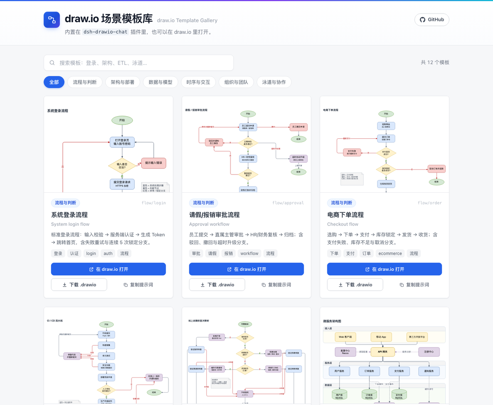

# dsh-drawio-chat

[](https://www.npmjs.com/package/dsh-drawio-chat) [](./LICENSE) [](https://xuedipiaofei.github.io/dsh-drawio-chat/)

DeepSeek Harness 的**聊天优先** draw.io 插件：模型创建、读取和修改原生 `.drawio` 文件，聊天里用 draw.io viewer 直接渲染，图始终留在工作区。

- **不登录 draw.io**、不需要 npx MCP server、不需要本地编辑器安装。
- 渲染发生在 **sandbox iframe** 里（opaque origin，模型生成的 XML 不会接触 GUI 源）。
- 参考文档工具 `drawio_reference` 从公开的 `https://mcp.draw.io/mcp` 取 draw.io 官方 XML 参考（无鉴权）；**图本身不上传**，取不到时回退内置精简参考。
- 内置**场景模板库**，并可发布同源的模板站；装了 `dsh-better-sidebar` 时，画布还会注册成它的 `.drawio` 文件查看器。
- 工具只能读写会话工作区内的 `.drawio` 文件；写入是原子的。

**链接** —— [在线模板站](https://xuedipiaofei.github.io/dsh-drawio-chat/) · [npm](https://www.npmjs.com/package/dsh-drawio-chat) · [社区市场条目](https://github.com/awesome-dsh-plugin/awesome-dsh-plugin)



## 怎么用

卡片是**结果**而不是入口：装好插件、重启 App 后，直接开一个对话描述你要的图即可。

1. **用自然语言提需求**，例如：
   - 「画一个系统登录流程图」
   - 「画一个请假审批流程，包含驳回和超时升级」
   - 「用微服务架构模板画一张，把服务改成用户/订单/支付」
2. **聊天里出现 draw.io 卡片**：可缩放、平移、看图层、翻页；底部按钮是 `下载 .drawio` / `导出 SVG` / `导出 PNG` / `在 draw.io 打开`。
3. **继续在同一个对话里改**：「把 Home 改成首页」「加一条 API→DB 的边」「撤销刚才的修改」——工具会原子地修改同一个文件，卡片自动刷新。
4. **文件落在工作区**：`diagrams/<标题>-<hash>.drawio`；点聊天里的文件链接、工作区文件树或右侧栏文件，会打开可交互的查看器标签页，而不是 XML 文本。

不需要任何额外配置：装好、重启、直接说需求就能用。

## 内置场景模板

不想从空白画布开始时，直接要一个常见场景，模型会从内置模板库实例化再按你的要求修改：

- 「用登录流程模板画一个」
- 「有哪些审批或工单的模板？」「给我看看数据管道的模板」
- 「用客服工单泳道模板画一个，把系统改成飞书」

`drawio_template` 工具负责列出/搜索模板并复制到 `diagrams/`。模板是原创内容、中英双语（图内中文标签）、Apache-2.0 许可；每个模板都通过校验（几何合法、形状不重叠、路径有明确起止）。

| 分类 | 内置模板 |
|---|---|
| `flowchart` | 系统登录流程 · 请假/报销审批流程 · 电商下单流程 · CI/CD 流水线 · 线上故障排查决策树 |
| `architecture` | 微服务架构图 · Web 应用部署架构 |
| `data` | 数据 ETL 流程 · 电商 ER 模型 |
| `sequence` | 登录时序图 |
| `org` | 团队组织架构图 |
| `swimlane` | 客服工单处理泳道图 |

模板目录是一份纯清单（`templates/catalog.json`：id、中英标题/描述、分类、标签、相对 `file`），同时是插件工具、测试和模板站的唯一数据源。

**模板站。** `site/` 是同一份 catalog 的零依赖静态站点：搜索、分类 chips、懒加载 draw.io 预览，每张模板带 **在 draw.io 打开 / 下载 .drawio / 复制提示词** 按钮（链接带 `?q=`，搜索结果可分享）。用 `node scripts/build-site.mjs` 构建（把 `site/` 和 `templates/` 复制进 `site-dist/`），用自带的 GitHub Pages workflow（`.github/workflows/pages.yml`）发布；仓库开启 Pages 后站点地址是 `https://xuedipiaofei.github.io/dsh-drawio-chat/`。

**社区模板目录。** `drawio_template` 支持可选的 `catalog` 参数——另一个 `catalog.json` 的公开 HTTPS 地址（例如模板站的）。它的条目会合并在内置模板之后，同样可搜索、可实例化；目录和模板都有大小/超时限制，只允许 HTTPS，拒绝 loopback/内网地址。远程目录拉取失败只会让列表降级为内置模板（带提示），而实例化远程 id 会直接报错。

**和 dsh-better-sidebar 一起用。** 装了那个插件时，draw.io 画布会注册为它的文件查看器（`registerFileViewer`，扩展名 `drawio`，`fsRead`）：在它的编辑器里成为 `.drawio` 的默认预览——停靠面板、浮窗和底部工作台都用同一个组件——查看器下拉框还能切回代码编辑器。之所以选文件查看器而不是单独做个底部面板 tab：一个组件覆盖所有表面，文件读取/刷新/Open with 流程仍由 better-sidebar 统一管理。没装 better-sidebar 时不注册任何东西，也不引入硬依赖。

新增模板：把 `.drawio` 放进 `templates/`、在 catalog 加一条记录，再运行 `python3 scripts/check-template.py templates/<file>`——测试套件里跑的是同一套检查。

## 功能一览

**画** —— 流程图、架构图、UML、ER、网络拓扑、线框等 draw.io 形状库；多页面、图层、容器与泳道；标签支持 LaTeX 排版。

**模板** —— 精选中文场景模板库（`drawio_template`）：按关键词/分类列出或搜索，一键实例化到工作区，之后和普通图一样修改。

**改** —— `drawio_read` 返回按 id/坐标/样式的结构摘要和当前 revision；`drawio_apply` 批量执行语义操作（标签、样式、增删节点与连线、移动、层序），原子写 + revision 冲突保护；`drawio_undo` 可回退到该文件最近 8 个版本中的任意一个。

**看** —— 聊天内嵌可交互的 draw.io viewer（缩放、平移、图层、翻页）；`.drawio` 文件在右侧栏直接预览，不再是 XML 文本；装了 `dsh-better-sidebar` 时，画布还是它默认的 `.drawio` 文件查看器。

**带** —— 下载 `.drawio`、导出 SVG 或 2× PNG、在 draw.io 打开；文件保存在 `diagrams/`，可随仓库提交。

**边界** —— 面向结构图、流程、架构和教学示意图。不做 3D 交互课件和视频，那需要另外的插件或渲染管线。

## 安装

发布到 npm 后：`dsh plugin --profile web add dsh-drawio-chat`（或桌面端在插件市场安装）。本地构建安装（桌面 App 独占 `desktop` profile，先 ⌘Q 退出）：

```sh
pnpm install && pnpm build
node scripts/install-into-desktop-profile.mjs --dry-run
node scripts/install-into-desktop-profile.mjs
```

安装后重启 App，让模型「画一张登录流程图」（`drawio_create`），聊天里出现 draw.io 视图，文件落在工作区 `diagrams/`。后续「把 Home 节点改名」走 `drawio_read` + `drawio_apply`，「撤销刚才的修改」走 `drawio_undo`。

## 已知限制

- 只接受 draw.io XML（`mxGraphModel`/`mxfile`），暂不支持 Mermaid 输入。
- 内联 viewer 脚本来自 `https://viewer.diagrams.net`（无账号要求，首次渲染需要联网）；离线包在计划中。
- 内置模板是起点：图内是中文通用文案，业务角色/系统名请按你的场景改名（或直接让模型改）。
- 远程/社区模板目录的可信度取决于 URL：插件只把模板当 `.drawio` XML 读取、不执行，但使用陌生目录前请先看来源。
- 不输出 3D 或视频——见上方「边界」。

## 验证

`pnpm typecheck`、`pnpm test`（16 文件 / 74 用例）、`pnpm build` 通过；模板测试会解析每个内置模板、校验连线端点并拒绝重叠形状；内联渲染用 headless Chrome 截图验证（`.harness/assets/viewer-sandbox-proof.png`）；SVG 与 PNG 导出都在 headless Chrome 里做了端到端验证（PNG：2400×1600 画布、84,368 字节、无 canvas taint）。
